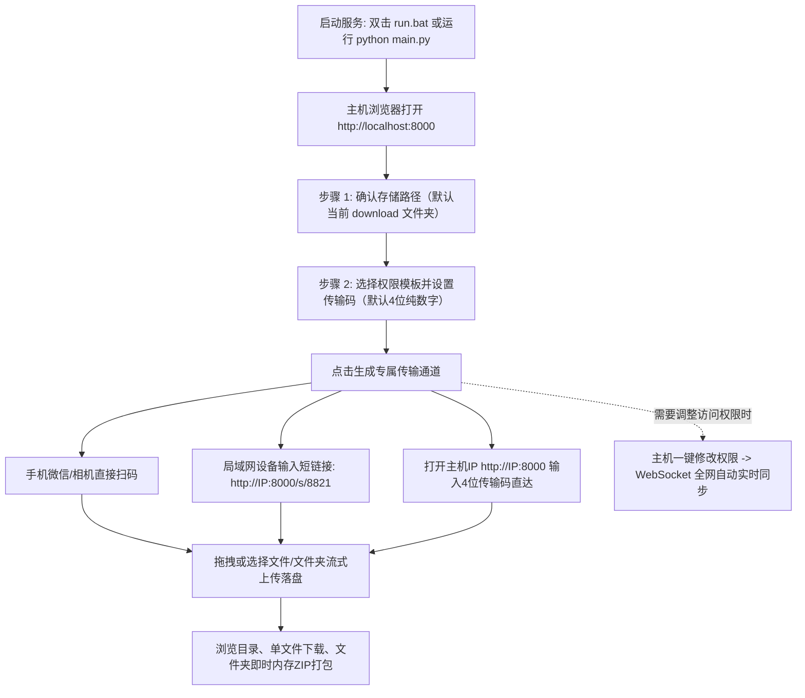

# 局域网点对点临时文件传输工具 (LAN File Shuttle)

一款轻量级、跨平台、即开即用的**局域网点对点临时文件传输与共享工具**。

应用采用**纯工具无痕属性**设计，不设立中心化数据库与中心化存储，所有文件均直接流式写入操作者本机的物理磁盘中。服务重启即焚，轻巧高效。

---

## 🌟 核心特性

- **跨平台与单命令运行**：支持 Windows、macOS 与 Linux，一键运行，极简工程结构。
- **开箱即用，默认 download 目录**：服务启动自动在根目录下创建并默认绑定 `download` 文件夹，省去繁琐配置。
- **极简 4 位口令与短链接**：
  - 默认自动生成 **4 位纯数字传输码**（如 `http://<局域网IP>:8000/s/8821`），在手机上仅需按 4 下数字键即可进入；
  - 支持**自定义传输码**（如 `8888`、`file` 或 `1`）；
  - 访客直接打开主机 IP 首页，提供 **「输入 4 位传输码直达」** 输入框，连长网址和 `/s/` 都无需记忆。
- **物理磁盘直落，纯内存无痕**：无 MySQL / SQLite 等传统数据库，会话与连接在内存中管理；上传文件直接流式写入操作者指定的磁盘目录，不产生任何临时垃圾元数据。
- **严格的主机与访客端安全隔离**：
  - **主机控制台权限隔离**：主控配置页（`/`）及管理接口（创建会话、修改权限、关闭通道等）**仅限本机管理员访问**，局域网外来设备无法越权操作；
  - **访客端隐私保护**：工作台彻底移除主控台超链接，隐藏主机的物理磁盘绝对路径，失效页面净化；
  - **严密防路径穿越（Directory Traversal）校验**，杜绝恶意相对路径越权访问根目录外部。
- **精细化多选权限与动态热调整**：
  - 🟩 **允许上传** (`upload`)：允许外来设备上传文件/文件夹直接落盘；
  - 🟦 **允许浏览** (`browse`)：允许查看当前目录及子目录结构；若关闭则自动变为**盲投收集箱模式**（保护作业/材料提交者的隐私，其他人看不到列表）；
  - 🟨 **允许下载** (`download`)：允许单文件直接下载或即时 ZIP 打包下载；若关闭则仅供在线浏览；
  - **随时动态修改权限**：通道创建后，主机管理员可随时在控制台或工作台一键调整权限，**所有已连接设备通过 WebSocket 即时自动同步刷新**，无需重新扫码或发链接。
- **强大的文件与文件夹流式传输**：
  - 支持任意文件格式（文档、音视频、压缩包、图片等）；
  - **完整保留文件夹多层级相对路径**：支持使用选择文件夹按钮上传，或直接将文件夹拖拽至上传区域，服务端按原相对路径自动递归建目录并落盘；
  - **大文件流式写入（Chunked Streaming）**：1MB 缓冲区流式读写，内存消耗恒定，避免大文件内存溢出；
  - **实时进度与速度监控**：前端精准展示当前总进度百分比、实时传输速度（MB/s）、已传输大小及文件队列状态。
- **文件夹即时内存 ZIP 打包流式下载**：
  - 支持单文件直接下载；
  - 当下载整个文件夹或子目录时，服务端采用 `zipstream` 进行**零临时文件、纯内存流式压缩传输**，边压缩边输出至浏览器，不产生任何磁盘暂存缓存。
- **WebSocket 实时无感协同**：
  - 当局域网内任意设备上传新文件后，通过 WebSocket 实时广播，所有在线工作台静默平滑刷新列表，无需手动刷新；
  - 实时显示当前会话在线设备数。
- **优雅的响应式 UI / UX**：
  - 基于 Tailwind CSS 扁平化卡片式设计，完美适配 PC 浏览器与手机/平板移动端。

---

## 📁 目录结构

```text
d:\平台文件\局域网传输/
├── download/            # 默认本地存储目录 (启动时自动创建，接收的文件保存在此)
├── main.py              # 后端主程序 (FastAPI, 局域网探测, 会话管理, 流式上传, 流式ZIP打包, WebSocket)
├── templates/
│   └── index.html       # 响应式单页面前端 (主机引导页 + 访客直达页 + 传输工作台 + 进度监控)
├── requirements.txt     # Python 依赖清单
├── run.bat              # Windows 双击一键启动脚本
├── run.sh               # Linux / macOS 一键启动脚本
├── test_suite.py        # 全量自动化集成测试套件
└── README.md            # 项目说明文档
```

---

## 📖 核心使用步骤与操作指南



---

### 第一步：一键启动服务（主机端电脑）

#### Windows 系统：
* 直接双击运行根目录下的 **`run.bat`**，或者在终端运行：
```powershell
python main.py
```

#### macOS / Linux 系统：
* 终端赋予权限并执行：
```bash
chmod +x run.sh
./run.sh
```

控制台将自动打印出本机在局域网中的访问地址：
```text
==================================================================
 [LAN File Shuttle] 局域网点对点临时文件传输工具 已启动
==================================================================
 * 本机访问地址:    http://127.0.0.1:8000
 * 局域网首选地址:  http://192.168.117.227:8000
------------------------------------------------------------------
```

> **可选参数**：
> ```bash
> python main.py --host 0.0.0.0 --port 8000 --reload
> ```

---

### 第二步：创建传输通道（主机端电脑）

1. 主机电脑打开浏览器，访问：**`http://localhost:8000`**；
2. **确认/配置通道信息**：
   * **本地存储路径**：已默认自动填入项目根目录下的 `download` 文件夹（接收到的文件全部保存在此，无需修改）；
   * **通道权限**：支持多选（可上传、可浏览、可下载），提供一键模板：
     * **全功能**（默认）：双方既能上传，也能互相查看并下载文件；
     * **仅上传 (收集箱模式)**：对方只能上传文件，看不到已传文件列表（适合收作业/材料，保护隐私）；
     * **仅浏览/下载**：对方只能查看和下载你的资料，禁止上传；
   * **自定义传输码（可选）**：
     * 可填入简短英文字母或数字（如 `8888`、`file` 或 `123`）；
     * 如果留空，系统会自动随机分配一个 **4 位数字口令**（如 `8821`）；
3. 点击 **「立即创建专属传输通道」**。

---

### 第三步：手机 / 局域网其他设备快速连接

> [!IMPORTANT]
> **连接前提**：其他设备（手机、平板、局域网电脑）必须连接在**同一个 Wi-Fi 或局域网路由器**下。

访客连接提供 **3 种极简方式**（任选其一）：

| 连接方式 | 具体操作 | 适用场景 |
| :--- | :--- | :--- |
| **方式 ①：扫码连接** | 手机直接使用微信或系统相机扫描主机屏幕上的二维码 | 📱 **手机端首选** |
| **方式 ②：短链接访问** | 浏览器直接输入极短链接（如 `http://192.168.117.227:8000/s/8821`） | 💻 电脑或平板浏览器 |
| **方式 ③：4 位码直达** | 浏览器直接打开主机 IP（`http://192.168.117.227:8000`），在页面中央输入 4 位数字口令（如 `8821`）点击“进入” | 🗣️ 办公室口口相传 |

---

### 第四步：文件收发与多端协同

1. **上传文件与完整文件夹**：
   * 支持点击按钮或直接拖拽文件/整个文件夹到网页虚线框中；
   * 自动递归解析并保留多层子文件夹相对路径，服务端自动建目录并落盘；
   * 采用 1MB 分块流式读写，内存消耗恒定，精准显示当前传输速度（MB/s）与百分比。
2. **浏览与下载**：
   * 列表支持面包屑多级导航与文件名即时搜索过滤；
   * 单击文件右侧“下载”直接下载单个文件；
   * 单击“打包下载当前目录 (ZIP)”，服务端采用内存流式压缩传输，无需等待生成临时文件，秒级弹出下载。
3. **多端实时无感协同**：
   * 局域网内任意设备上传新文件后，所有在线工作台通过 WebSocket **静默平滑刷新列表**，无需手动按刷新键。

---

### 第五步：随时动态修改通道权限（主机专属）

通道开放后，若需临时关闭上传、开启仅下载或切换为收集箱：
1. **控制台修改**：在主机主控端（`http://localhost:8000`）右侧的活跃会话卡片上点击 **「修改权限」**；
2. **工作台修改**：主机管理员在自己的专属工作台页面顶部，点击权限标签旁的 **「修改权限」**；
3. 在弹出的权限窗口中调整勾选，点击 **「保存修改」**；
4. **所有连接中的手机和外部设备将即时收到通知并自动同步刷新界面**，无需重新扫码或重新发链接。

---

## ⚡ 传输速度与优化技巧

| 影响因素 | 实际效果 | 优化建议 |
| :--- | :--- | :--- |
| **Wi-Fi 频段 (2.4G vs 5G)** | 2.4G 容易受干扰（通常仅 3~8 MB/s）；5G / Wi-Fi 6 速度可达 40~90 MB/s | 手机和无线设备请优先连接 **5G 频段 Wi-Fi** |
| **主机连接方式 (有线 vs 无线)** | 双无线设备对传会共享路由器无线空口，速度折半；主机插网线可跑满千兆上限 | 主机电脑尽量插**千兆有线网线**连接路由器 |
| **小文件打包** | 成千上万个几 KB 的小文件会因高频创建文件句柄导致速度下降 | 大量零碎小文件建议在本地**压缩成一个 ZIP** 后再上传 |

> [!TIP]
> 推荐配置：**主机电脑插千兆网线 + 手机连 5G Wi-Fi**，传输速率通常可达到 **70 ~ 110 MB/s**。

---

## 🔒 安全机制与设计约束

1. **主机/访客严格隔离**：
   - 主机管理控制台（`/`）和所有管理 API 仅允许本机（localhost / 127.0.0.1）访问；
   - 外部局域网 IP 访问根路径仅展示访客专属说明与 4 位码输入页，彻底杜绝越权进入主控端；
   - 访客端工作台完全隐藏主机的磁盘物理绝对路径。
2. **防路径穿越（Path Traversal）**：
   - 上传路径与下载路径强制执行规范化路径检查，对包含 `..` 等越权探测直接拦截并返回 HTTP 400。
3. **大小防护**：
   - 单文件上传上限为 **1GB**；
   - 文件夹内存即时 ZIP 打包下载上限为 **1GB**。
4. **纯内存无痕**：
   - 进程退出即焚，不占用系统数据库服务，重启后所有会话通道自动失效。
